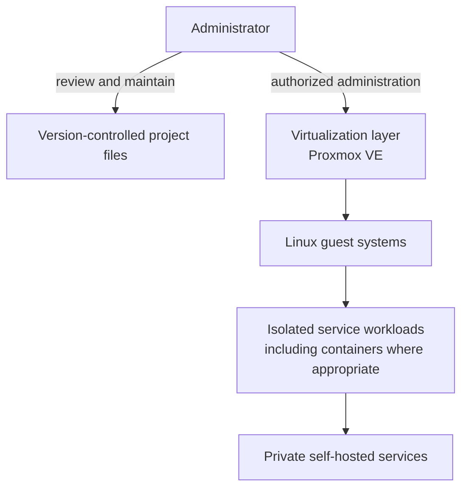

# High-Level Architecture

This diagram is a **conceptual portfolio view**, not a map of the live environment. It intentionally omits hostnames, addresses, network ranges, service names, access paths, and node counts.

## Design principles

- **Isolation:** keep workloads separated according to their purpose and risk.
- **Least privilege:** use administrative access only when required and avoid sharing credentials between services.
- **Change control:** review and version configuration changes instead of making undocumented edits.
- **Recoverability:** maintain backups for important data and verify that restoration is possible.
- **Limited exposure:** keep administrative interfaces and private services off the public internet unless there is a deliberate, secured requirement.
- **Operational clarity:** document service ownership, dependencies, validation steps, and recovery actions without publishing private infrastructure details.

## Scope and accuracy

This is a generalized representation of the project's technical approach. It is not intended to confirm the current status of any particular host, guest, container, or service.
